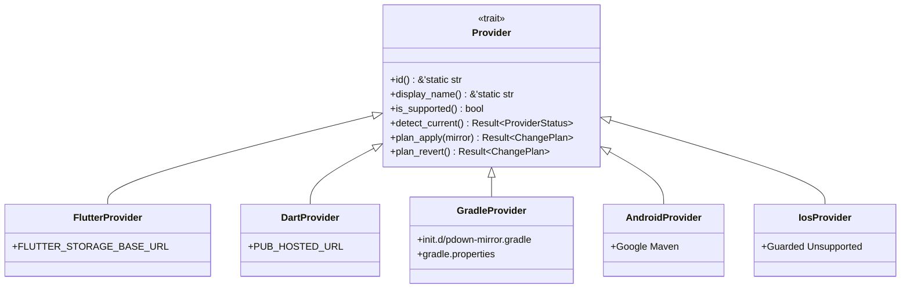

# PackageDownloader 2.0 — Provider System Guide

**Status:** Production Standard  
**Architecture:** Provider Trait Abstraction (`crate::core::provider::Provider`)

---

## 1. Ecosystem Providers Overview

PackageDownloader 2.0 isolates each development ecosystem into an independent provider module with its own detection, planning, application, and recovery behaviors.

---

## 2. Detailed Provider Specifications

### 2.1 Flutter Provider (`src/providers/flutter.rs`)
- **Managed Variable:** `FLUTTER_STORAGE_BASE_URL`
- **Domain Responsibility:** Directs the Flutter SDK toolchain to download engine binaries, pre-compiled artifacts, and SDK archives from an authorized Google Cloud Storage (GCS) proxy.
- **Safety Rule:** Must **never** be pointed to mirrors that only proxy Dart Pub (`pub.dev`). Setting `FLUTTER_STORAGE_BASE_URL` to an incompatible Pub mirror causes `flutter precache` and `flutter upgrade` to fail with HTTP 404 HTML error pages.
- **Supported Mirrors:** `runflare` (`https://mirror-gcs.runflare.com`), `flutter-cn` (`https://storage.flutter-io.cn`).
- **Unsupported:** `pub-azs` does not mirror `flutter_infra_release` SDK artifacts.

### 2.2 Dart / Pub Provider (`src/providers/dart.rs`)
- **Managed Variable:** `PUB_HOSTED_URL`
- **Domain Responsibility:** Controls package downloads for `dart pub get` and `flutter pub get`.
- **Validation:** Probed via standard Pub API endpoint `/api/packages/<pkg>`.
- **Supported Mirrors:** `pub-azs` (`https://pub-azs.ir`), `runflare` (`https://mirror-flutter.runflare.com`), `flutter-cn` (`https://pub.flutter-io.cn`).

### 2.3 Gradle Provider (`src/providers/gradle.rs`)
- **Managed Paths:**
  - Init Script: `~/.gradle/init.d/pdown-mirror.gradle`
  - Properties: `~/.gradle/gradle.properties`
- **Non-Destructive Integration:** Never modifies the user's primary `~/.gradle/init.gradle`. Uses Gradle's built-in `init.d/` auto-discovery directory.
- **Endpoint Separation:** Strictly separates repository redirects:
  - Maven Central -> `MAVEN_CENTRAL_MIRROR`
  - Google Maven (`dl.google.com/dl/android/maven2/`) -> `GOOGLE_MAVEN_MIRROR`
  - Gradle Plugin Portal (`plugins.gradle.org/m2/`) -> `GRADLE_PLUGINS_MIRROR`
  - Gradle Distribution Wrapper (`services.gradle.org/distributions/`) -> `DISTRIBUTION_MIRROR`
- **Socket Timeouts:** Automatically appends HTTP connection and socket timeouts (120,000 ms) in `gradle.properties` within managed block tags to prevent timeout dropouts on congested networks.

### 2.4 Android Provider (`src/providers/android.rs`)
- **Domain Responsibility:** Manages repository access for Android Gradle Plugin (AGP), Android Support Libraries, and AndroidX dependencies.
- **Coordination:** Coordinates with `GradleProvider` to redirect `https://dl.google.com/dl/android/maven2/` to certified Google Maven mirrors (e.g. `pub-azs` or `jamko`).

### 2.5 iOS Provider (`src/providers/ios.rs`)
- **Status:** Guarded Unsupported (`is_supported() = false`)
- **Reasoning:** Neither CocoaPods CDN nor Swift Package Manager (SPM) has an active, authenticated, reliable mirror in Iran. Attempting to hijack CocoaPods CDN URLs without genuine mirror backends corrupts CocoaPods specs repositories and breaks iOS builds.
- **Diagnostics:** When queried, the CLI provides clear, informative guidance explaining the status.
