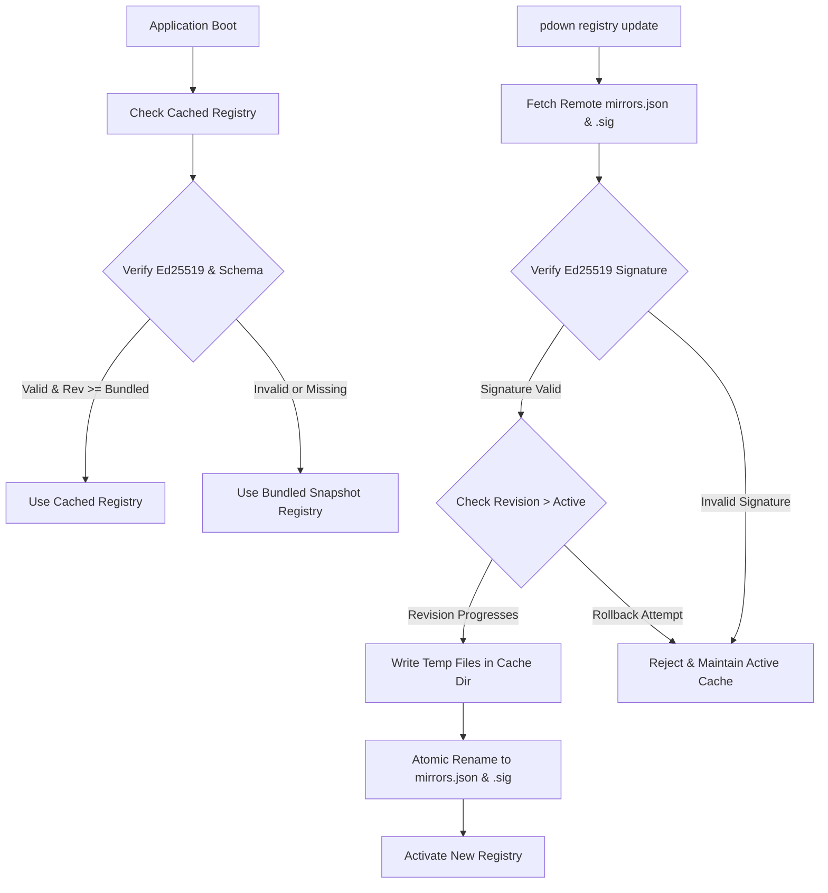

# PackageDownloader Registry Specification

**Specification Version:** 1.0.0  
**Target Schema:** `registry/schema.json`  
**Canonical Source:** `https://raw.githubusercontent.com/IR-Flutter/PackageDownloader/main/registry/mirrors.json`

---

## 1. Objective

The PackageDownloader Remote Mirror Registry allows the CLI application to update its mirror repository catalog dynamically without requiring an application binary recompile or redistribution.

---

## 2. Document Schema & Top-Level Fields

| Field | Type | Description |
| :--- | :--- | :--- |
| `schema_version` | integer | Incremented only when the JSON structure changes in backward-incompatible ways. Current supported: `1`. |
| `registry_version` | string | Semantic version (`MAJOR.MINOR.PATCH`) reflecting content additions or modifications. |
| `revision` | integer | Strictly monotonically increasing positive integer. Replay and rollback protection mechanism. |
| `updated_at` | string (ISO-8601) | Timestamp of publication in UTC. |
| `mirrors` | array | List of mirror definitions. |

---

## 3. Mirror Definition Fields

Each object in the `mirrors` array represents a distinct mirror provider entity:

| Field | Type | Description |
| :--- | :--- | :--- |
| `id` | string | Unique kebab-case identifier (e.g., `pub-azs`, `runflare`, `flutter-cn`). |
| `name` | string | Human-readable display name. |
| `description` | string | Detailed description in Persian or English. |
| `website` | string (URL) | Official website or status portal of the mirror. |
| `enabled` | boolean | Global flag enabling or disabling the mirror across the application. |
| `priority` | integer (optional) | Sorting hint for listings and auto-selection (lower = higher priority). |
| `providers` | object | Ecosystem-specific configuration mapping. |

### 3.1 Provider Configuration Matrix

- **Flutter (`providers.flutter`):**
  - `enabled`: boolean
  - `storage_url`: Base URL for Google Cloud Storage artifacts (must support `flutter_infra_release`).
  - `test_path`: Relative probe path for health check (default: `flutter_infra_release/releases/releases_linux.json`).

- **Dart (`providers.dart`):**
  - `enabled`: boolean
  - `hosted_url`: Base URL for Pub packages (`PUB_HOSTED_URL`).
  - `test_package`: Package name to query during health checks (e.g. `http`).

- **Gradle (`providers.gradle`):**
  - `enabled`: boolean
  - `maven_central_url`: Maven Central mirror endpoint.
  - `google_maven_url`: Android Google Maven mirror endpoint (`dl.google.com/dl/android/maven2/`).
  - `gradle_plugins_url`: Gradle Plugin Portal mirror endpoint (`plugins.gradle.org/m2/`).
  - `distribution_url`: Gradle wrapper distribution ZIP repository (`services.gradle.org/distributions/`).

- **Android (`providers.android`):**
  - `enabled`: boolean
  - `google_maven_url`: Android SDK Maven artifact mirror endpoint.

- **iOS (`providers.ios`):**
  - `enabled`: boolean
  - `notes`: Diagnostic notes regarding mirror availability or technical limitations.

---

## 4. Operational Resolution Hierarchy

