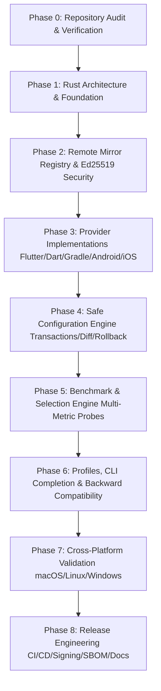

# PackageDownloader 2.0 — Engineering Roadmap

**Project:** PackageDownloader 2.0  
**Repository:** `IR-Flutter/PackageDownloader`  
**Target Completion:** Production Release 2.0.0

---

## 1. Roadmap Milestones & Phases

---

## 2. Phase-by-Phase Plan & Acceptance Criteria

### Phase 0 — Repository Audit & Technical Baseline (Completed)
- [x] Full audit of legacy Dart codebase (`irflutter` v1.1.0).
- [x] Direct technical probe of `pub-azs.ir`, `runflare.com`, `chrepo.ir`, and other endpoints.
- [x] Identified broken assumptions (PUB-AZS storage 404, Gradle Google Maven clobbering).
- [x] Generated `docs/audit/REPOSITORY_AUDIT.md`.
- [x] Generated `docs/architecture/SOFTWARE_ARCHITECTURE.md`.
- [x] Generated `docs/architecture/TECHNICAL_DESIGN.md`.
- [x] Generated `docs/ROADMAP.md`.

---

### Phase 1 — Rust Architecture & Foundation
- **Goals:** Establish Cargo workspace, core data types, error handling hierarchy with `thiserror`, CLI routing with `clap`, structured logging with `tracing`, and directory layout.
- **Dependencies:** None.
- **Acceptance Criteria:**
  - `Cargo.toml` configured with required crates (`clap`, `tokio`, `serde`, `serde_json`, `thiserror`, `anyhow`, `tracing`, `directories`, `ed25519-dalek`, `reqwest`).
  - Strict compiler linting (`-D warnings`, `clippy::all`).
  - Working baseline CLI: `cargo run -- --help` and `cargo run -- --version`.
  - Core domain models compile and unit test suite executes cleanly.

---

### Phase 2 — Remote Mirror Registry & Cryptographic Security
- **Goals:** Implement Bundled, Cached, and Remote registries with JSON schema validation, version comparison, anti-rollback checks, and Ed25519 signature verification.
- **Dependencies:** Phase 1.
- **Acceptance Criteria:**
  - Canonical `registry/mirrors.json` and JSON schema `registry/schema.json` created.
  - Ed25519 keypair generation tooling and registry signing test cases.
  - Three-tier loader: Bundled -> Cached -> Remote.
  - Offline fallback verified (application boots without network).
  - Malformed or tampered signatures rejected immediately.
  - Anti-rollback revision enforcement tested.

---

### Phase 3 — Provider Subsystem
- **Goals:** Implement modular providers for Flutter, Dart/Pub, Android, and Gradle. Implement diagnostic unsupported guard for iOS.
- **Dependencies:** Phase 2.
- **Acceptance Criteria:**
  - `FlutterProvider` manages `FLUTTER_STORAGE_BASE_URL` with verified storage endpoint.
  - `DartPubProvider` manages `PUB_HOSTED_URL`.
  - `GradleProvider` routes repositories safely (`init.d/pdown-mirror.gradle` and `gradle.properties` timeouts) without destroying user `init.gradle`.
  - `AndroidProvider` handles Android SDK / Google Maven repositories.
  - `IosProvider` returns structured diagnostic guidance explaining mirror unavailability.

---

### Phase 4 — Safe Configuration Engine & Transactions
- **Goals:** Implement snapshot backups, atomic file writes, before/after diffs, dry-run mode, ownership markers, and multi-provider rollback stack.
- **Dependencies:** Phase 3.
- **Acceptance Criteria:**
  - No file is ever modified without an automatic pre-write backup in `~/.local/share/pdown/backups`.
  - `--dry-run` displays unified color diff without writing to disk.
  - Atomic rename (`tempfile` -> target) protects against partial writes.
  - Mid-transaction failure cleanly rolls back all previously applied changes.

---

### Phase 5 — Benchmark & Selection Engine
- **Goals:** Replace naive HTTP ping with real multi-stage health probes (DNS, TCP, TLS, endpoint-specific probe).
- **Dependencies:** Phase 3.
- **Acceptance Criteria:**
  - `pdown test` outputs latency, TTFB, and reachability per ecosystem endpoint.
  - Pub probe tests `/api/packages/http`.
  - Gradle probe tests real POM artifacts.
  - Storage probe tests `flutter_infra_release`.
  - Fast-mirror auto-selection based on real weighted score.

---

### Phase 6 — Profiles, CLI Polish & Backward Compatibility
- **Goals:** Implement profile management (`default`, `iran`, `custom`), JSON output mode across all commands, and `irflutter` command compatibility shim.
- **Dependencies:** Phase 4, Phase 5.
- **Acceptance Criteria:**
  - `pdown list --json`, `pdown status --json`, `pdown test --json` output valid machine-readable JSON.
  - Symlink / binary alias `irflutter` routes seamlessly to `pdown`.
  - Profile switching persists independent configurations.

---

### Phase 7 — Cross-Platform Validation & Testing
- **Goals:** Rigorous testing on macOS (Apple Silicon + Intel), Linux x64, and Windows x64.
- **Dependencies:** Phase 6.
- **Acceptance Criteria:**
  - Unit tests pass with >80% code coverage.
  - Integration tests with isolated temporary environments pass.
  - Shell environment modification verified for `zsh`, `bash`, and Windows user environment.
  - No leaks or modifications to the host development environment during automated tests.

---

### Phase 8 — Release Engineering, CI/CD & Documentation
- **Goals:** Production CI/CD workflows, automated formatting/clippy/testing, SHA-256 checksums, SBOM generation, signed installer scripts, and complete documentation.
- **Dependencies:** Phase 7.
- **Acceptance Criteria:**
  - Pinned GitHub Actions workflow `.github/workflows/ci.yml` and `.github/workflows/release.yml`.
  - Secure `install.sh` and `install.ps1` with SHA-256 validation.
  - Complete documentation (`docs/REGISTRY_SPECIFICATION.md`, `docs/USAGE.md`, `README.md`, etc.).
  - Reproducible release binaries with checksum manifests.
