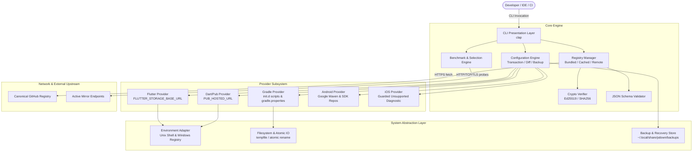

# PackageDownloader 2.0 — Software Architecture

**Version:** 2.0.0-draft  
**Status:** Approved  
**Language & Runtime:** Rust (2021 Edition, MSRV 1.75+)  
**Primary Binary:** `pdown` (symlinked/aliased as `irflutter` for backwards compatibility)

---

## 1. Architecture Overview & Goals

PackageDownloader 2.0 is a native, cross-platform Development Environment Mirror Manager. Its architectural design centers around four core tenets:

1. **Safety First:** User configuration files (`.zshrc`, `.bashrc`, `~/.gradle/`, environment variables) are never treated as disposable. All modifications are transactional, previewable via dry-run, backed up automatically, and 100% reversible.
2. **Provider Isolation:** Flutter SDK storage, Dart Pub, Gradle repositories, Android Google Maven, and Gradle distributions are handled by independent providers with strict domain boundaries.
3. **Dynamic Verifiable Registry:** Mirror definitions are decoupled from the binary. Updates are pulled from a canonical HTTPS repository, validated against an Ed25519 cryptographic signature, cached locally, and supported by an offline bundled fallback snapshot.
4. **Zero-Dependency Native Execution:** Compiles to standalone native binaries with zero external runtime dependencies (no Dart, Java, Python, or shell interpreter dependencies required for core logic).

---

## 2. High-Level Architectural Diagram



---

## 3. Subsystem Breakdown

### 3.1 Presentation Layer (`src/app/`)
- **CLI Router (`cli.rs`):** Built with `clap` (derive API) supporting subcommands, global flags (`--dry-run`, `--json`, `--verbose`, `--scope`), and bash/zsh/fish/powershell shell completion generation.
- **Commands (`commands/`):** Implements handler logic for:
  - `list` / `ls`: Enumerate mirrors with ecosystem capability matrix.
  - `status`: Inspect system environment variables, managed Gradle scripts, and active profile.
  - `test` / `benchmark`: Run provider-specific latency, reachability, and throughput benchmarks.
  - `use <mirror-id>`: Apply mirror configurations with `--only` filter and `--dry-run` preview.
  - `reset`: Safely revert environment variables and managed configuration files to official defaults.
  - `doctor`: Inspect system prerequisites, PATH, file permissions, and conflicting configs.
  - `registry status|check|update`: Manage the remote registry cache and cryptographic validation.
  - `profile list|switch|create`: Manage multi-tenant configuration profiles.

### 3.2 Core Registry System (`src/core/registry/`)
- **Hierarchy of Trust:**
  1. **Remote Registry:** Downloaded over HTTPS from GitHub; must match schema and pass Ed25519 signature verification against the embedded public key.
  2. **Cached Registry:** Stored locally in `$XDG_DATA_HOME/pdown/cache/mirrors.json`. Monotonically validated by revision and timestamp.
  3. **Bundled Registry:** Compiled directly into the binary via `include_str!` as an offline guarantee.
- **Fail-Safe Operation:** If remote fetch fails (offline, rate-limited, DNS block), the application automatically falls back to the validated cache, and finally to the bundled registry. Startup is never blocked by network availability.

### 3.3 Safe Configuration Engine (`src/system/backup/` & `src/core/transaction/`)
- **Ownership Tagging:** All written blocks contain cryptographic or distinct markers (`# >>> Managed by pdown [UUID] >>>`).
- **Pre-flight Diff:** Generates a unified diff of proposed changes prior to execution.
- **Backup Snapshot:** Before altering any file, copies the exact file state to the managed backup store with timestamp and SHA-256 hash.
- **Atomic File Writing:** Writes to a temporary file on the same filesystem and performs an atomic rename, preventing file corruption on crash or SIGINT.
- **Rollback Journal:** If applying changes across multiple providers fails midway, the transaction rollback stack reverts previously modified settings in reverse order.

### 3.4 Provider Implementations (`src/providers/`)
Each provider implements the `Provider` trait:

```rust
pub trait Provider: Send + Sync {
    fn id(&self) -> &'static str;
    fn display_name(&self) -> &'static str;
    fn is_supported(&self) -> bool;
    fn detect_current(&self) -> Result<ProviderStatus>;
    fn plan_apply(&self, mirror: &MirrorDefinition) -> Result<ChangePlan>;
    fn apply(&self, plan: &ChangePlan, backup: &mut BackupJournal) -> Result<()>;
    fn plan_revert(&self) -> Result<ChangePlan>;
    fn revert(&self, plan: &ChangePlan, backup: &mut BackupJournal) -> Result<()>;
    fn benchmark_target(&self, mirror: &MirrorDefinition) -> Option<BenchmarkTarget>;
}
```

- **FlutterProvider:** Manages `FLUTTER_STORAGE_BASE_URL`. Validates that the endpoint actually hosts `flutter_infra_release` artifacts.
- **DartPubProvider:** Manages `PUB_HOSTED_URL`. Validates standard pub api `/api/packages/` compatibility.
- **GradleProvider:** Avoids overwriting user's root `init.gradle`. Manages `~/.gradle/init.d/pdown-mirror.gradle` and safely adjusts timeout properties in `gradle.properties`. Distinguishes Google Maven vs Maven Central vs Gradle Plugin Portal.
- **AndroidProvider:** Manages repository definitions specific to the Android toolchain.
- **IosProvider:** Explicitly marked as unsupported; returns actionable diagnosis when probed.

### 3.5 Benchmark & Selection Engine (`src/core/benchmark/`)
- Evaluates DNS lookup time, TCP handshake, TLS negotiation, and HTTP response code.
- Executes real artifact payload probes (e.g., retrieving actual POM bytes or package info), not just generic HTTP HEAD/GET against web homepages.
- Emits reproducible latency and packet loss metrics to enable automatic fast-mirror selection.

---

## 4. Platform Support Matrix

| Platform | Target Architecture | Environment Strategy | Gradle User Home |
| :--- | :--- | :--- | :--- |
| **macOS Apple Silicon** | `aarch64-apple-darwin` | Managed block in user shell profiles (`~/.zshrc`, `~/.bashrc`) | `~/.gradle` |
| **macOS Intel** | `x86_64-apple-darwin` | Managed block in user shell profiles (`~/.zshrc`, `~/.bashrc`) | `~/.gradle` |
| **Linux x64** | `x86_64-unknown-linux-gnu` | Managed block in `~/.bashrc` / `~/.profile` | `~/.gradle` or `$GRADLE_USER_HOME` |
| **Windows x64** | `x86_64-pc-windows-msvc` | Persistent User Registry (`HKCU\Environment`) via Win32 API | `%USERPROFILE%\.gradle` |

---

## 5. Security Architecture

1. **Digital Signatures:** Registry payloads are signed with Ed25519. The application embeds the public key:
   `PDOWN_REGISTRY_PUBLIC_KEY`
2. **Untrusted Payload Sanitization:** All URLs fetched from remote registries are parsed and validated (must be HTTPS; no localhost or internal IP spoofing).
3. **No Root / Admin Required:** All operations are scoped strictly to the current user's home directory and user-level environment variables.
4. **Supply Chain Hardening:** Pinned GitHub Actions, automated `cargo audit`, SBOM generation, SHA-256 checksums, and reproducible release builds.
